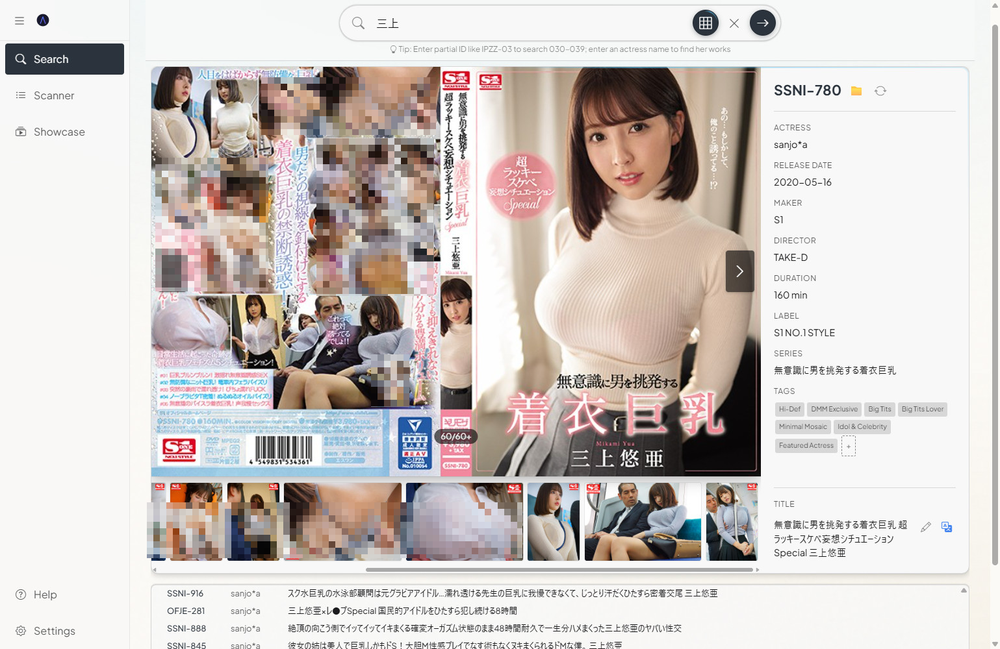
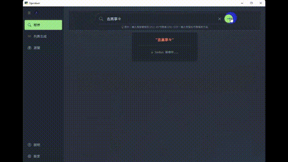
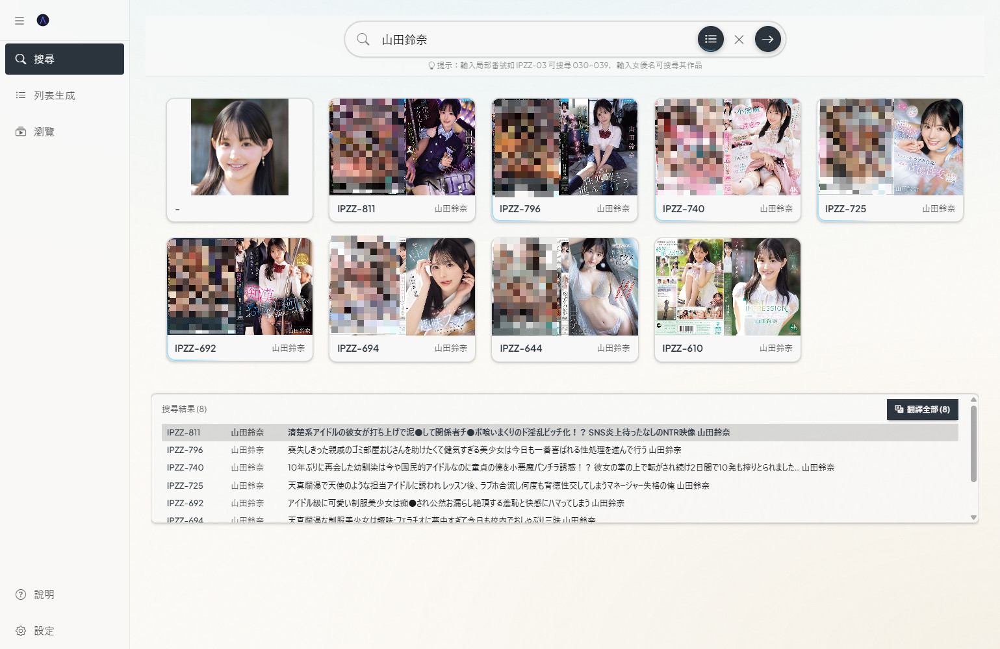
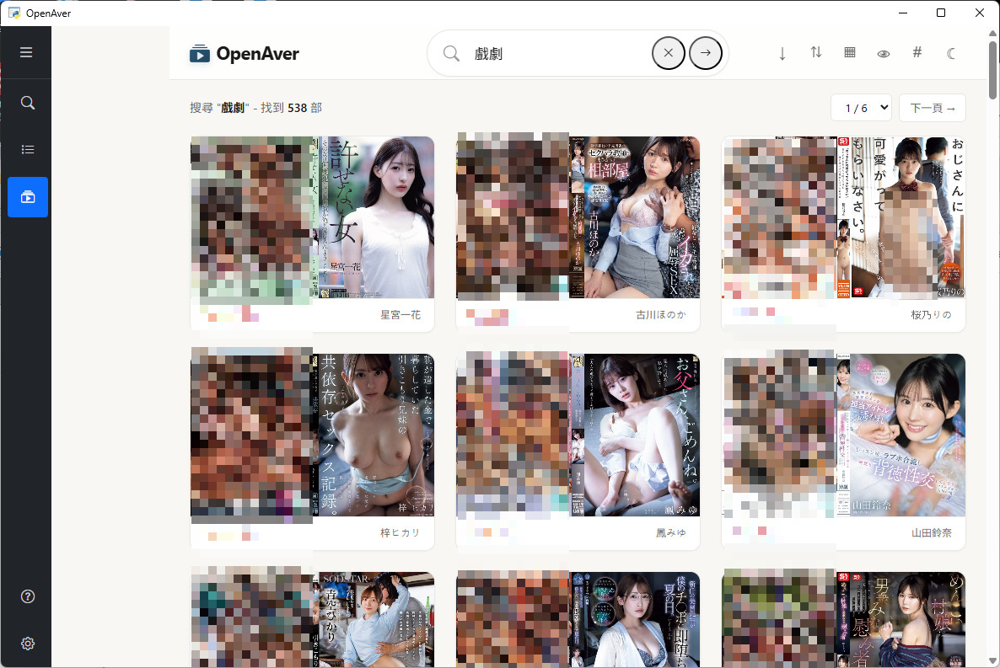

<!-- OpenAver: free open-source desktop GUI JAV metadata scraper & manager. No Docker, no CLI,
one-line install (Windows/macOS). Reads NFO + covers already organized by JavSP/EverAver/MDCX/
Jellyfin/Emby without re-scraping. Cover-wall browser with actress as a first-class entity
(cup/age/height sort, cross-language alias) plus a library-insights dashboard. 8 built-in scrape
sources (JavBus/Jav321/JavDB/DMM/D2Pass/HEYZO/FC2/AVSOX) + optional Metatube federation (30+)
+ custom YAML sources an AI agent can write for any site with per-title pages. The desktop app can
also connect to a library hosted on a NAS or another PC. Optionally exports NFO + covers to
Jellyfin/Emby/Kodi. AI-operable REST API, 3,300+ tests, MIT. -->

<h1 align="center">OpenAver</h1>

<p align="center">
  <strong>Your ID collection — browse by cover, find by actress.</strong><br>
  Works right after install on Windows/Mac, no Docker, no command line · Bring in videos you already organized and browse them right away, no re-scraping needed
</p>


English | **[繁體中文](README.md)**

Point OpenAver at the folder where you keep your videos and it turns them into a cover wall: click a cover to see stills and tags, click an actress to see all her titles, click a tag to find similar ones; whatever's missing, one click fills it in from the web.

**The "Open" in OpenAver means you're never locked in:**

- **Open to come in**: collections already organized by JavSP, MDCX, or EverAver are read as-is — no re-scraping. If a video has a data file next to it (NFO — a small file that holds the title, actress, and tags) and a cover image, scanning reads it in and leaves your files untouched; the same goes for Jellyfin/Emby or any other tool that writes a standard NFO + cover.
- **Open to leave**: the data files and covers it writes are recognized by Jellyfin/Emby/Kodi, so you can play on your TV; if you ever stop using OpenAver, everything is still in your own folders.
- **Open source**: MIT licensed and free — anyone can read or change the code.

**By default, nothing about your videos is changed, moved, or deleted.** Filling in missing metadata only adds a data file and images next to the video. Only when you press "Organize" does it rename or move files, following the rules you set, and it never deletes. It runs on your own computer; no account needed.

**100% local** — no data collection, no uploaded file info. Network requests are only used to scrape publicly available metadata.

⚡ **[Live Demo → openaver.slive.uk](https://openaver.slive.uk/)**

*Just mecha villains and fictional movie posters inside — zero NSFW. Safe even if your boss walks by.*

## Spec Sheet

| Item | Details |
|------|---------|
| **Platform** | Windows 10/11 · macOS (Apple Silicon, M1 and later) |
| **Install** | One-line command or double-click installer, no Docker, everything runs in the GUI |
| **Inherit an existing collection** | Reads the NFO and cover images already sitting next to your videos — scanning never changes your files |
| **Collection browsing** | Cover wall with stackable filters; actress wall sortable by cup size, age, height |
| **Library insights** | Count, year, maker, actress, tag; select several at once, one click jumps to Showcase |
| **Phone & tablet** | Phones/tablets on the same Wi-Fi can browse it in a browser; closed to the outside world by default, password optional |
| **Library on a NAS** | The desktop app connects to it; your own player, subtitles, and human verification aren't limited by the browser |
| **Scrape sources** | Queries 8 at once: JavBus, Jav321, JavDB, DMM, D2Pass, HEYZO, FC2, AVSOX; 2 more need manual verification; can add Metatube (30+), or ask an AI to add custom sources |
| **Media player output** | Organizing can generate the NFO and covers Jellyfin/Emby/Kodi need |
| **AI control** | AI tools like Claude Code/Cursor can organize your library directly from instructions |
| **AI translation** | Ollama (local, free)/Gemini/Claude/OpenAI-compatible endpoints |
| **License** | MIT, no account, no data uploaded |

## Screenshots

| Search | Actress Collection |
|--------|--------------------|
|  |  |

<details>
<summary>More screenshots</summary>

| Search Demo | Actress Search |
|-------------|----------------|
|  |  |

| Showcase · Videos | Showcase · Single Title |
|-------------------|-------------------------|
|  |  |

</details>

---

## Installation

### One-Line Install

**macOS** (open "Terminal" and paste this):
```bash
curl -fsSL https://raw.githubusercontent.com/slive777/OpenAver/main/install.sh | bash
```

**Windows** (open PowerShell and paste this):
```powershell
irm https://raw.githubusercontent.com/slive777/OpenAver/main/install.ps1 | iex
```

> 💡 Don't want to open PowerShell? Download `OpenAver-Windows-Setup.bat` from [Releases](https://github.com/slive777/OpenAver/releases/latest) and double-click to install.

The install command downloads the latest version and clears the system's security restrictions. On Windows it also creates a desktop shortcut. Upgrading keeps your settings, and the installer follows your system language.

### Manual ZIP Download

Download from [GitHub Releases](https://github.com/slive777/OpenAver/releases/latest):

| Platform | File |
|----------|------|
| **Windows x64** | `OpenAver-vX.X.X-Windows-x64.zip` |
| **macOS arm64** | `OpenAver-vX.X.X-macOS-arm64.zip` |

> ⚠️ The manual ZIP needs one extra step to clear security restrictions — see the included document. macOS is Apple Silicon only.

The first time you open it, an onboarding tour walks you through picking a folder and pressing "Update Library" — no need to read the docs first.

> 🐧 **Linux**: No official installer, but you can set it up yourself as a LAN server and use it from a browser — see [`docs/linux-server.md`](docs/linux-server.md).

> 🗄️ **Synology NAS**: Install the `.spk` manually (beta) — see [`docs/synology.md`](docs/synology.md).

---

## Core Features

### 📋 Library Manager: Bring your existing collection in first

- **Recognizes what others already organized**: reads a `.nfo`'s title, actress, tags, maker, series, and date, plus covers with common names (`-poster`, `fanart`, `folder`…) and `extrafanart/`.
- **Fills only what's missing**: titles missing an NFO or cover are listed, one click fills them in from the web; only empty fields are filled, existing data is never overwritten.
- **Actress/tag aliases**: add them right in the UI. Chinese/Japanese/English names, stage names, and post-retirement names collapse into one card; the old or the new name gives the same list of titles.
- **Reorder sources yourself**: drag to set your preferred order, one click switches to "uncensored mode."
- **Keeps subtitles, preserves VR tags when moving files**: subtitle files move along with the video, VR projection tags (`_180_LR`, `mkx200`) are kept so your media player still recognizes them.

### 🎬 Showcase: Browse by cover, find by actress

**A media player finds videos by filename; here you browse by cover, tag, and actress.**

- **Cover wall + Lightbox**: click a cover to see stills, tags, and actress info; uncensored covers auto-crop to the face, drag to adjust if you don't like it.
- **Collected actresses show their age on release day**: her name is followed by something like `(28y)` — her age on the day that title released.
- **Stackable filters**: click an actress, tag, maker, director, or series and only titles matching all of them stay; clicking is an exact match, typing is a fuzzy search.
- **One-click switch between landscape cover and portrait card**: a landscape JAV cover's front is its right half, so portrait cards fit more per row — purely a display change.
- **Actress mode**: actresses get their own wall, profile cards with height, cup size, measurements, age, alias history; sortable and filterable.
- **Fill the actress wall from your own library**: press `+` for a list of who's in your library and how many titles each has, aliases merged; tap the heart to add.
- **Similar exploration**: tap the wand and similar titles circle the main cover; works offline.
- **Shows up right after organizing**: a title organized on the Search page flies straight into Showcase; if your library location can't be reached, the status bar names which one.
- **Browse on phone or tablet too**: flip to "Server" in Settings and same-Wi-Fi devices can browse in a browser; flip back to "Standalone" to close access. The interface is redone for touch.
- **Browse offline too**: one click in Settings exports an offline page you can open without the app.

### 🔍 Search: where new titles come in

- **Queries all 8 sources at once**: matched against your library, collected titles are flagged; JavDB goes through its official app's data channel, so it still works even when blocked, and covers come back without a watermark.
- **Drag in files or a folder**: IDs are recognized automatically, metadata is looked up in batch, and covers and stills are pulled in. UC/LEAK/4K in a filename becomes a tag.
- **Dropping a folder reads only that top level, not subfolders**: for your whole library, add it with "Scan Folders" on the Library Manager page.
- **Fuzzy search relays across three sources**: type an actress, series, director, maker, or ID prefix and it lists their titles. JavBus, DMM, and JavDB take turns in your order; DMM includes pre-orders.
- **Latest works from makers**: before you search, the makers you've collected from most recently are listed under the search box; click one to see what it released lately.
- **Look before you organize**: check the cover, cast, and tags in the detail view first; only when you press "Organize" does it rename, create the folder, write the NFO, and download the cover.
- **Wishlist**: save a title you want but don't own yet. Its cover is stored locally so it won't break if the source site goes down, and it disappears once the title is collected.
- **Scheduled Organize**: a toggle next to "Inbox" (your finished-downloads folder) looks up and organizes that folder every 12 hours; you can also run it right away.
- **Re-scrape titles already in your library**: change the ID or pick a source, preview, then decide whether to overwrite; your current title is kept by default, and the NFO title format is customizable.

### 📊 Library Insights: turn your whole library into charts

- **The big picture first, then one level deeper**: count, year, maker, actress Top 25, tags; below that, age on release day, directors, series, maker timeline, and frequent co-stars.
- **Click to narrow, and you can combine**: select years, actresses, and makers together, drag out a range of years, and every chart updates.
- **Jump straight to what you want**: click a count, tag, director, or series to open Showcase with your current filters and see those titles; actresses you haven't collected can be added here in one click.

### 📀 Read-only sources: videos on a NAS stay untouched and still reach your media player

Want to plug a NAS or cloud mount into Jellyfin/Emby/Kodi without copying terabytes of original files? Mark that source **read-only**.

- **Not a single byte of the source is touched**: the NFO, covers, and stills are all written to a local output folder you choose.
- **`.strm` feeds your media player directly**: a tiny file that only says where the video is. Emby and Kodi play the original file when they scan it, no copying needed.
- **Since Jellyfin 10.11.7, `.strm` can only hold a URL**; one with a disk path won't play. If you already have a URL (for example through Alist / OpenList), fill in the start of it in "Playback-side path mapping" (e.g. `/volume1/cloud` → `http://nas:5244/d/115`).
- **Works even when the two machines see different paths**: set a replacement rule and paths are rewritten automatically; existing `.strm` files are updated too.

### 🌐 AI Translation

- A translate button sits next to the title in the lightbox. One click turns a Japanese title into your UI language; the original is kept and you can undo.
- Supports **Ollama** (local, free), **Gemini Flash**, **Claude**, and **OpenAI-compatible endpoints**.

### 🔌 Connect Metatube (Advanced, optional)

In Advanced Settings you can connect your self-hosted [Metatube](https://github.com/metatube-community/metatube-sdk-go) for 30+ more sources, covering uncensored titles and niche makers.

### 🧩 Custom sources: add a website as a source

For titles the built-in sources don't cover — Chinese-language videos, anime, a studio's own official site — you can add the site as a source, as long as each title has its own ID page and it's viewable without logging in.

- **Just tell an AI**: "Add https://… as a custom source for OpenAver." The AI writes the rule file, uploads it, runs the check, and turns it on if it passes.
- **The rule file is only settings**: it just says where the title, cover, and actress are, and runs no code. To write one by hand, see [`docs/custom-sources.md`](docs/custom-sources.md).
- **How to use it**: after a title is in your library, pick it when you re-scrape with ⚙ in the lightbox. New-title import and automatic search don't use it. If the site changes its layout, run the check again.

Want the wand's similar-title orbit to also compare how covers look? Ask an AI assistant to set up an image-similarity endpoint from [`docs/external-ai.md`](docs/external-ai.md); without one, similarity stays rule-based.

### 🤖 Let an AI agent manage your library

OpenAver has a local description file for AI to read. Claude Code and Cursor read it and chain several steps on their own, doing the chores you'd rather not do one by one:

- **"Add my top 20 actresses by video count to Favorites, skip the ones already saved."**
- **"橋本ありな and 新ありな are the same person and she's retired — add a tag for that."**
- **"Turn the IDs mentioned in this article into an HTML page with covers."**
- **"Every Monday, check whether my collected actresses have new titles, and add them to the wishlist."**
- **"I want metadata for this website's titles too — add it as a source."**

One curl teaches your AI every endpoint (the port is shown in the "AI API" section of the Settings page):

```bash
curl http://localhost:<port>/api/capabilities
```

<details>
<summary>Supported AI tools · Advanced usage · Power-user easter egg</summary>

Works with any function-calling AI tool:

| Method | Tool | Notes |
|--------|------|-------|
| **CLI** | Claude Code, Codex CLI, Gemini CLI, Aider, etc. | curl straight from the terminal |
| **IDE** | Cursor, GitHub Copilot in VS Code, Windsurf, Trae, etc. | Agent mode calls the local REST API |
| **Desktop App** | Codex App, Google Antigravity 2.0, Claude Cowork, OpenClaw | No dev environment needed |

> 💡 Want to see covers right in the chat? **Codex App** and **Google Antigravity 2.0** both support inline display.

> ⚡ Small models work too: Gemini Flash, GPT mini, and Claude Haiku can all operate it.

> 🪄 **Power-user easter egg: auto-find actresses in FC2 titles.** Almost no FC2 video has an actress tag, but plenty later debuted in censored titles. SQL pulls titles with an empty actress field → DeepFace matches them against Gfriends → `POST /api/user-tags` writes it back; 50 lines of Python chew through your whole library, unidentified ones get auto-clustered via DBSCAN.

</details>

---

## FAQ

**Can videos organized by OpenAver be used with Jellyfin/Emby/Kodi, or alongside them?**
Yes. Organizing also generates the NFO and cover art, and the video stays where it is. Jellyfin, Emby, and Kodi show it once they scan the folder. OpenAver handles finding titles and browsing; they handle playback.

**My videos are on a NAS or cloud drive and I don't want them moved or changed — can I still use OpenAver?**
Yes. Mark the folder "read-only": the originals are untouched, and data files and covers go to a local folder. External drives work too. It can also generate `.strm` files for Emby/Kodi to play (since Jellyfin 10.11.7 a `.strm` can only hold a URL, see above).

**Will OpenAver move, rename, or delete my files?**
Only when you press "Organize" are files renamed or moved, and it never deletes; a same-name file warns you first. Nothing else touches your videos, and filling in missing metadata only adds an NFO and cover next to them.

**I want to switch computers or back things up — what do I need to copy?**
Your settings, library database, actress photos, thumbnails, and wishlist covers all live together in `app/output/`; copy that one folder to move machines or back up.

**Does it work on Mac? Do I need Docker?**
Yes. Apple Silicon only (M1 and later), one command or a ZIP, no Docker.

**My library is on a NAS — can the desktop app connect to it directly?**
Yes. Run OpenAver on the NAS (Synology package or Linux) or another computer, then enter its address and password under "Connect" in the desktop app's sidebar. Compared with a browser you get three extras: your own player (which can read `.srt`), the JavLibrary / FC2-javten human verification, and opening the folder a video is in. If paths differ, set up a path mapping. The host needs 0.17.7 or later.

**Can I browse the videos on my computer from my phone or tablet?**
Yes. On the same Wi-Fi, turn on "Server" in Settings and open the URL in your phone's browser; turn it off when done so nothing is exposed to the internet.

**What if one of the built-in scrape sources stops working?**
The 8 sources fill in for each other, so if one fails the rest can still find the title. JavDB also has an app channel, so it usually still works even when blocked. You can also connect Metatube, or ask an AI to add a source.

**Can I get metadata for titles the built-in sources don't have (Chinese-language videos, anime)?**
Yes. If each title on that site has its own ID page and needs no login, ask an AI to add it as a custom source. After the title is in your library, pick it when you re-scrape with ⚙ in the lightbox.

**Can I still get metadata for titles the official sites have taken down?**
Yes. In the desktop app, JavLibrary and FC2-javten open a window for you to click once, then the result is filled in automatically. Manual exact-ID lookup only: no batch search, and not available to AI.

**Can AI tools operate OpenAver?**
Yes. OpenAver has a local description file for AI to read. Tools like Claude Code and Cursor read it with one command, then can organize your library, favorite actresses, and add tags.

**On Windows, can it keep running in the background after I close the window?**
Yes — it minimizes to the system tray and keeps running; click the icon to reopen. Clicking the X asks whether to exit or minimize, with a "don't ask again" option; change this later under Settings → System.

---

## Developer Guide

<details>
<summary>Tech stack · Run from source · Directory structure · Building</summary>

### Tech Stack

| Layer | Technology |
|-------|-----------|
| **Backend** | FastAPI (Python 3.12) |
| **Frontend** | Jinja2 + DaisyUI + Tailwind CSS + Alpine.js 3.x + Fluent Design 2 |
| **Animation** | GSAP 3.14+ + Motion Adapter (reduced-motion support) |
| **Desktop** | PyWebView (Windows/macOS) |
| **Database** | SQLite (WAL mode) |
| **Testing** | Pytest (3,300+ tests) |

### Run from Source

**Prerequisites**: Python 3.12 (matches the packaged build), Chrome/Edge, [WebView2 Runtime](https://go.microsoft.com/fwlink/p/?LinkId=2124703) (Windows 10/VM)

```bash
git clone https://github.com/slive777/OpenAver.git
cd OpenAver
python3 -m venv venv
source venv/bin/activate  # Windows: venv\Scripts\activate
pip install -r requirements.txt

# Development mode (hot reload)
uvicorn web.app:app --reload --reload-include 'locales/*.json' --host 127.0.0.1 --port 8000

# Desktop mode (Windows)
python windows/launcher.py
```

### Running Tests

```bash
source venv/bin/activate
pytest
```

### Directory Structure

```
OpenAver/
├── web/                # Web GUI (FastAPI)
│   ├── routers/
│   │   ├── capabilities.py  # 🌟 AI Manifest — self-describing definitions for every endpoint (single file)
│   │   └── ...              # Other business endpoints (search / scanner / scraper / actress / ...)
│   ├── templates/      # HTML templates (DaisyUI + Fluent Design 2)
│   └── static/         # CSS/JS assets (modular JS, theme CSS)
├── core/               # Core logic
│   ├── scrapers/       # Modular scrapers (JavBus/JavDB/Jav321/FC2/AVSOX/DMM/D2Pass/HEYZO + manual sources JavLibrary/FC2-javten)
│   ├── database/       # SQLite data layer package (connection/video/actress/alias/tag_alias/migrate, WAL)
│   ├── metatube/       # Metatube federation integration
│   ├── similar/        # Rule-based similar-title ranking (tag IDF + series/maker/actress)
│   ├── focal/          # Uncensored-cover face-focus cropping
│   ├── gallery_scanner.py    # Folder scanning & library import (reads existing NFO/covers)
│   ├── organizer.py    # File organizing + null-value fallback guards
│   ├── readonly_producer.py  # Read-only source → NFO/cover/.strm output
│   ├── path_utils.py   # Cross-platform path handling (file:// URI)
│   ├── i18n.py         # i18n core (t() / fallback chain)
│   └── translate_service.py  # AI translation (Ollama/Gemini/Claude/OpenAI Compatible)
├── locales/            # 4-locale JSON (zh_TW/zh_CN/ja/en)
├── tests/              # Test suite (Pytest)
└── windows/            # Windows launcher (PyWebView)
```

### Building Packages

```bash
source venv/bin/activate
python build.py          # Windows
python build_macos.py    # macOS
```

</details>

---

## Troubleshooting

> 💡 See the Troubleshooting document included in the packaged ZIP, or check the [GitHub Wiki](https://github.com/slive777/OpenAver/wiki).

---

## Community & Reporting Issues

Join the [Telegram group](https://t.me/+J-U2l96gv0FjZTBl) to chat!

| Channel | Best For |
|---------|----------|
| [GitHub Issues](https://github.com/slive777/OpenAver/issues) | Bug reports, feature requests, dev discussions |
| [Telegram group](https://t.me/+J-U2l96gv0FjZTBl) | Privacy-sensitive issues, direct screenshot/video uploads |

**When reporting, please include**: a description, steps to reproduce, OS version, and the log file (from the Debug startup script).

---

## Acknowledgements

OpenAver uses and is grateful for these open-source projects:

- **[FastAPI](https://fastapi.tiangolo.com/)** — Modern Python web framework
- **[PyWebView](https://pywebview.flowrl.com/)** — Lightweight cross-platform desktop framework
- **[GSAP](https://gsap.com/)** — High-performance JavaScript animation engine
- **[DaisyUI](https://daisyui.com/)** — Component library for Tailwind CSS
- **[Tailwind CSS](https://tailwindcss.com/)** — Utility-first CSS framework
- **[Alpine.js](https://alpinejs.dev/)** — Lightweight JavaScript framework
- **[Apache ECharts](https://echarts.apache.org/)** — Charting library for the Library Insights page

Full list of third-party package versions and licenses: [`docs/THIRD_PARTY.md`](docs/THIRD_PARTY.md).

## License

MIT License

---

<details>
<summary>⚠️ Disclaimer</summary>

This project is intended for personal, non-commercial use only. By using OpenAver, you agree to:
- Respect the terms of service of any website you scrape
- Use reasonable request rates
- Not use this software for commercial purposes

You assume full responsibility for any consequences arising from your use of this project.

</details>
